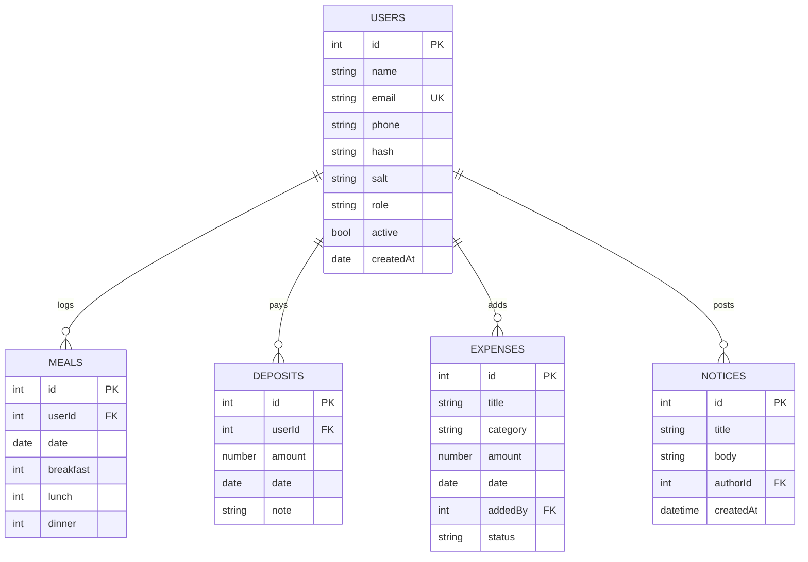

# MessMate — Hostel / Mess Meal & Expense Manager

A multi-user web application that replaces the paper "bazar khata" used in student hostels and shared flats.
Members log their meals, the manager approves bazar (grocery) expenses and records deposits, and the system
automatically calculates the **meal rate** and every member's **balance** each month.

> Final Lab Project — Web Application Development

**Live demo:** `<paste your deployed link here>`  ·  **Video:** `<paste YouTube link here>`

## Problem statement
In most student messes the monthly hisab is done by hand: meals are counted in a notebook, expenses are
scribbled on paper, and disputes about who owes what are common. MessMate makes the numbers transparent,
tamper-resistant and instantly available to everyone.

## Objectives
- Digitise daily meal entry, bazar expenses and member deposits.
- Calculate meal rate = total approved expense ÷ total weighted meals, and each member's cost/balance.
- Provide role-based access (Manager vs Member) with secure authentication.
- Offer reports (on-screen, CSV, print) and a notice board.

## Features
| Area | What it does |
|---|---|
| Authentication | Register, login, logout, signed HttpOnly session cookie, scrypt-hashed passwords |
| Roles | **Manager (admin)** and **Member** with server-side authorization on every route |
| Dashboard | Meal rate, my meals, cost, balance, quick "today's meals", notices, daily spending chart |
| Meals | Members set meals for today/future only; manager can edit any date for any member |
| Bazar expenses | Members submit → manager approves/rejects; search + category + status filters |
| Deposits | Manager records deposits; members see their own |
| Monthly report | Per-member hisab, category breakdown, CSV export, print view |
| Notice board | Manager posts announcements |
| Profile | Edit details, change password |
| Manager panel | Change roles, activate/deactivate/delete members, set mess name and breakfast weight |
| Responsive UI | Works on phone, tablet and desktop |

## Tech stack
- **Front end:** HTML5, CSS3 (custom, responsive, print styles), vanilla JavaScript (fetch API, canvas chart)
- **Back end:** Node.js (built-in `http`, `crypto`, `fs` — **zero npm dependencies**), REST/JSON API
- **Database:** JSON-file database (`data/db.json`) with atomic writes behind a small data-access layer (`lib/db.js`)
- **Security:** scrypt password hashing, HMAC-signed session tokens, role checks, input validation, HTML escaping, path-traversal protection

## Project structure
```
messmate/
├── server.js            # HTTP server, session handling, API dispatch
├── lib/
│   ├── db.js            # JSON database (CRUD + atomic save)
│   ├── auth.js          # password hashing + signed tokens
│   ├── http.js          # router, body parser, static files
│   ├── routes.js        # all REST endpoints + monthly report logic
│   └── seed.js          # demo data on first run
├── public/              # front end
│   ├── index.html login.html register.html
│   ├── dashboard.html meals.html expenses.html deposits.html
│   ├── reports.html notices.html profile.html admin.html 404.html
│   ├── css/style.css
│   └── js/              # app.js (shared) + one script per page
├── test/smoke.js        # automated API checks (npm test)
└── package.json
```

## Run locally
Requires Node.js 18 or newer. No `npm install` needed.
```bash
git clone <your-repo-url>
cd messmate
npm start            # http://localhost:3000
npm test             # optional: runs automated API checks
```
A demo database is created on the first start.

| Role | Email | Password |
|---|---|---|
| Manager | manager@messmate.com | admin123 |
| Member | karim@messmate.com | member123 |

Set `NO_SEED=1` to start with an empty database — the **first user who registers becomes the Manager**.

## Database design (ER diagram)


## Core calculation
```
weighted meals  = breakfast × breakfastWeight (default 0.5) + lunch + dinner
meal rate       = total approved expenses ÷ total weighted meals
member cost     = member meals × meal rate
member balance  = member deposits − member cost
```

## REST API summary
| Method | Endpoint | Access |
|---|---|---|
| POST | `/api/auth/register`, `/api/auth/login`, `/api/auth/logout` | public / any |
| GET | `/api/auth/me` | logged in |
| PUT | `/api/profile`, `/api/profile/password` | logged in |
| GET/PUT/DELETE | `/api/users`, `/api/users/:id` | list: all · change/delete: manager |
| GET/POST/DELETE | `/api/meals` | members: own, future only · manager: all |
| GET/POST/DELETE | `/api/expenses`; PUT `/api/expenses/:id/status` | add: all · approve/reject: manager |
| GET/POST/DELETE | `/api/deposits` | read: own/all · write: manager |
| GET/POST/DELETE | `/api/notices` | read: all · write: manager |
| GET | `/api/report`, `/api/report/csv` | logged in |
| PUT | `/api/settings` | manager |

## Deploy for free (Render.com)
1. Push this folder to a **public GitHub repository**.
2. On [render.com](https://render.com) → **New → Web Service** → connect the repo.
3. Runtime: **Node** · Build command: *(leave empty)* · Start command: `npm start` · Plan: **Free**.
4. Deploy, then copy the `https://…onrender.com` link into this README and Google Classroom.

> Free hosts have an ephemeral disk, so data may reset when the service restarts. That is fine for a demo —
> the seed data re-creates itself. To keep data permanently, set `DB_FILE` to a path on a persistent disk,
> or swap `lib/db.js` for SQLite/MongoDB (only that one file touches storage). Railway, Koyeb and Glitch also work.

## Challenges & solutions
- **Fair money maths:** floating-point rounding → all amounts rounded to 2 decimals; a test checks member costs sum to total expense.
- **Tamper-proof meals:** members can't edit past days — enforced on the server, not just in the UI.
- **Session security without libraries:** HMAC-signed tokens in HttpOnly cookies using Node's `crypto`.
- **Safe file storage:** write-to-temp-then-rename keeps `db.json` valid even if the process stops mid-write.

## Future improvements
SMS/email reminders, guest-meal counts, bazar duty roster, multiple messes per account,
SQL database, per-member charts, installable mobile app (PWA).

## Author
`<Your name>` · `<Student ID>` · Web Application Development Lab
